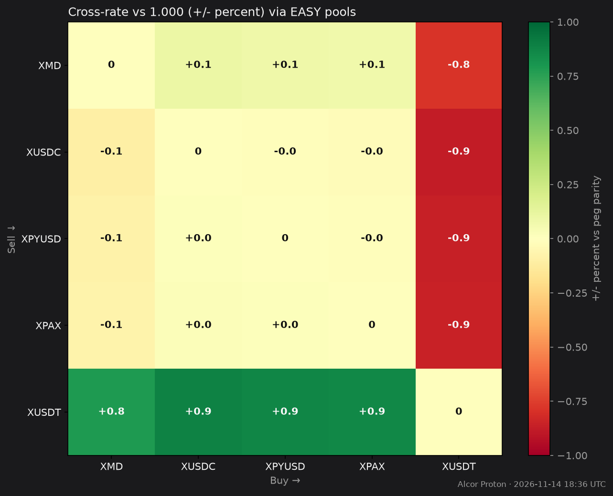
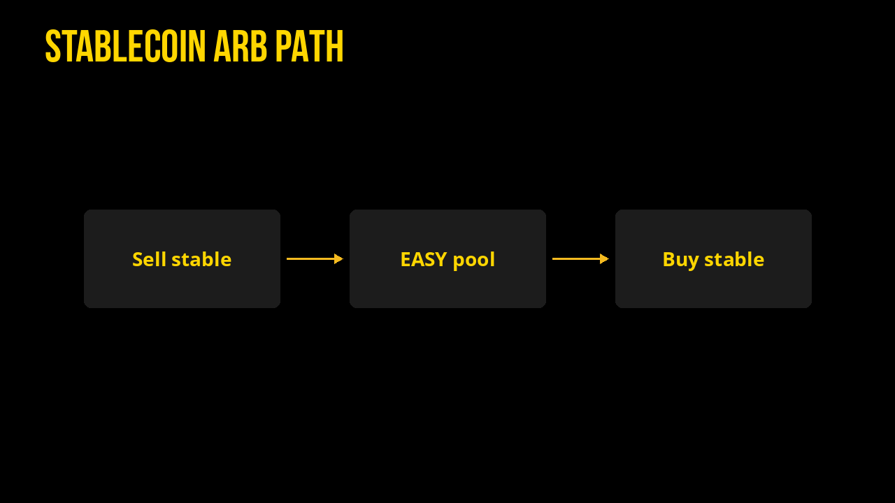

# Stablecoin Arbitrage (XPR)

Dated cross-rates for selling each of **XMD · XUSDC · XPYUSD · XPAX · XUSDT** into the others on Alcor (XPR Network).

*Snapshot: **2026-11-10 20:06 UTC** · Primary path: deepest **EASY**↔stable pools*

## Cross-rate heatmap (+/- percent)

## How to read

- Rows = **sell** this coin. Columns = **buy** that coin.
- Cell = how many **buy** tokens you get per **1.0 sell** token (implied), routing **sell → EASY → buy**.
- Heatmap / percent table = distance from 1.0000 (parity) as **+/- percent** (green when you receive more than 1.0 of a same-peg asset after fees/slippage). Always simulate on [Alcor Swap](https://alcor.exchange/v/xpr/swap) before sizing.

Fees, hop slippage, and pool depth can erase small edges. EASY transfer tax (2%) applies when EASY moves to non-exempt accounts. Prefer routing that stays inside `swap.alcor` memos when possible.

## Implied rates via EASY (amount of Buy per 1 Sell)

| Sell ↓ \ Buy → | XMD | XUSDC | XPYUSD | XPAX | XUSDT |
| --- | ---: | ---: | ---: | ---: | ---: |
| **XMD** | 1.000000 | 1.000048 | 0.996321 | 1.000359 | 0.998912 |
| **XUSDC** | 0.999952 | 1.000000 | 0.996274 | 1.000311 | 0.998864 |
| **XPYUSD** | 1.003692 | 1.003740 | 1.000000 | 1.004053 | 1.002600 |
| **XPAX** | 0.999641 | 0.999689 | 0.995964 | 1.000000 | 0.998553 |
| **XUSDT** | 1.001089 | 1.001137 | 0.997407 | 1.001449 | 1.000000 |

### Same matrix as +/- percent vs 1.000

| Sell ↓ \ Buy → | XMD | XUSDC | XPYUSD | XPAX | XUSDT |
| --- | ---: | ---: | ---: | ---: | ---: |
| **XMD** | +0.00 | +0.00 | -0.37 | +0.04 | -0.11 |
| **XUSDC** | -0.00 | +0.00 | -0.37 | +0.03 | -0.11 |
| **XPYUSD** | +0.37 | +0.37 | +0.00 | +0.41 | +0.26 |
| **XPAX** | -0.04 | -0.03 | -0.40 | +0.00 | -0.14 |
| **XUSDT** | +0.11 | +0.11 | -0.26 | +0.14 | +0.00 |

## Standout legs (this snapshot)

- Sell **XPYUSD** → buy **XPAX**: **1.004053** (+0.41% vs parity) via EASY
- Sell **XPYUSD** → buy **XUSDC**: **1.003740** (+0.37% vs parity) via EASY
- Sell **XPYUSD** → buy **XMD**: **1.003692** (+0.37% vs parity) via EASY
- Sell **XPYUSD** → buy **XUSDT**: **1.002600** (+0.26% vs parity) via EASY
- Sell **XUSDT** → buy **XPAX**: **1.001449** (+0.14% vs parity) via EASY
- Sell **XPAX** → buy **XPYUSD**: **0.995964** (-0.40% vs parity) via EASY
- Sell **XUSDC** → buy **XPYUSD**: **0.996274** (-0.37% vs parity) via EASY
- Sell **XMD** → buy **XPYUSD**: **0.996321** (-0.37% vs parity) via EASY
- Sell **XUSDT** → buy **XPYUSD**: **0.997407** (-0.26% vs parity) via EASY
- Sell **XPAX** → buy **XUSDT**: **0.998553** (-0.14% vs parity) via EASY

## EASY pool anchors

**Stable TVL** = USD value of the non-EASY side only (XMD / XUSDC / XPYUSD / XPAX / XUSDT depth in that pool).

| Stable | Pool | EASY per 1 stable | Stable TVL | 24h vol |
| --- | --- | ---: | ---: | ---: |
| XMD | [4067](https://alcor.exchange/v/xpr/analytics/pools/4067) | 56.5522 | $504 | $95 |
| XUSDC | [4065](https://alcor.exchange/v/xpr/analytics/pools/4065) | 56.5495 | $13,850 | $4,809 |
| XPYUSD | [4068](https://alcor.exchange/v/xpr/analytics/pools/4068) | 56.7610 | $13,640 | $455 |
| XPAX | [4070](https://alcor.exchange/v/xpr/analytics/pools/4070) | 56.5319 | $13,990 | $614 |
| XUSDT | [4066](https://alcor.exchange/v/xpr/analytics/pools/4066) | 56.6138 | $13,819 | $1,586 |

### Alcor mark prices

| Stable | usd_price |
| --- | ---: |
| XMD | $1.0001 |
| XUSDC | $1.0000 |
| XPYUSD | $0.9923 |
| XPAX | $1.0072 |
| XUSDT | $1.0000 |
