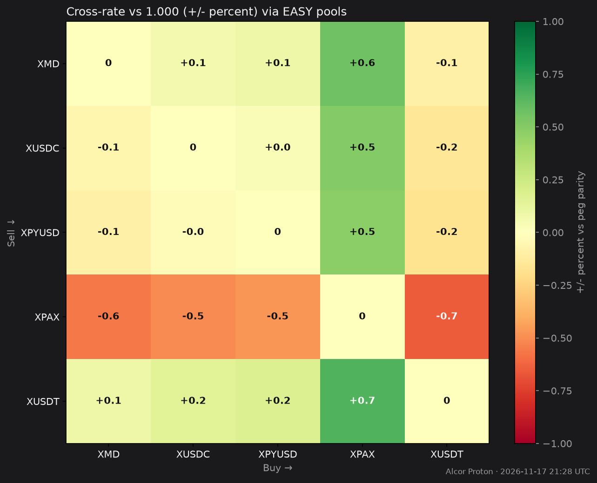

# Stablecoin Arbitrage (XPR)

Dated cross-rates for selling each of **XMD · XUSDC · XPYUSD · XPAX · XUSDT** into the others on Alcor (XPR Network).

*Snapshot: **2026-11-21 19:53 UTC** · Primary path: deepest **EASY**↔stable pools*

## Cross-rate heatmap (+/- percent)

## How to read

- Rows = **sell** this coin. Columns = **buy** that coin.
- Cell = how many **buy** tokens you get per **1.0 sell** token (implied), routing **sell → EASY → buy**.
- Heatmap / percent table = distance from 1.0000 (parity) as **+/- percent** (green when you receive more than 1.0 of a same-peg asset after fees/slippage). Always simulate on [Alcor Swap](https://alcor.exchange/v/xpr/swap) before sizing.

Fees, hop slippage, and pool depth can erase small edges. EASY transfer tax (2%) applies when EASY moves to non-exempt accounts. Prefer routing that stays inside `swap.alcor` memos when possible.

## Implied rates via EASY (amount of Buy per 1 Sell)

| Sell ↓ \ Buy → | XMD | XUSDC | XPYUSD | XPAX | XUSDT |
| --- | ---: | ---: | ---: | ---: | ---: |
| **XMD** | 1.000000 | 0.999172 | 0.968925 | 0.981761 | 0.973416 |
| **XUSDC** | 1.000829 | 1.000000 | 0.969728 | 0.982575 | 0.974223 |
| **XPYUSD** | 1.032071 | 1.031217 | 1.000000 | 1.013247 | 1.004635 |
| **XPAX** | 1.018578 | 1.017734 | 0.986926 | 1.000000 | 0.991501 |
| **XUSDT** | 1.027310 | 1.026459 | 0.995386 | 1.008572 | 1.000000 |

### Same matrix as +/- percent vs 1.000

| Sell ↓ \ Buy → | XMD | XUSDC | XPYUSD | XPAX | XUSDT |
| --- | ---: | ---: | ---: | ---: | ---: |
| **XMD** | +0.00 | -0.08 | -3.11 | -1.82 | -2.66 |
| **XUSDC** | +0.08 | +0.00 | -3.03 | -1.74 | -2.58 |
| **XPYUSD** | +3.21 | +3.12 | +0.00 | +1.32 | +0.46 |
| **XPAX** | +1.86 | +1.77 | -1.31 | +0.00 | -0.85 |
| **XUSDT** | +2.73 | +2.65 | -0.46 | +0.86 | +0.00 |

## Standout legs (this snapshot)

- Sell **XPYUSD** → buy **XMD**: **1.032071** (+3.21% vs parity) via EASY
- Sell **XPYUSD** → buy **XUSDC**: **1.031217** (+3.12% vs parity) via EASY
- Sell **XUSDT** → buy **XMD**: **1.027310** (+2.73% vs parity) via EASY
- Sell **XUSDT** → buy **XUSDC**: **1.026459** (+2.65% vs parity) via EASY
- Sell **XPAX** → buy **XMD**: **1.018578** (+1.86% vs parity) via EASY
- Sell **XMD** → buy **XPYUSD**: **0.968925** (-3.11% vs parity) via EASY
- Sell **XUSDC** → buy **XPYUSD**: **0.969728** (-3.03% vs parity) via EASY
- Sell **XMD** → buy **XUSDT**: **0.973416** (-2.66% vs parity) via EASY
- Sell **XUSDC** → buy **XUSDT**: **0.974223** (-2.58% vs parity) via EASY
- Sell **XMD** → buy **XPAX**: **0.981761** (-1.82% vs parity) via EASY

## EASY pool anchors

**Stable TVL** = USD value of the non-EASY side only (XMD / XUSDC / XPYUSD / XPAX / XUSDT depth in that pool).

| Stable | Pool | EASY per 1 stable | Stable TVL | 24h vol |
| --- | --- | ---: | ---: | ---: |
| XMD | [4067](https://alcor.exchange/v/xpr/analytics/pools/4067) | 58.7407 | $519 | $664 |
| XUSDC | [4065](https://alcor.exchange/v/xpr/analytics/pools/4065) | 58.7894 | $12,777 | $5,251 |
| XPYUSD | [4068](https://alcor.exchange/v/xpr/analytics/pools/4068) | 60.6246 | $12,310 | $413 |
| XPAX | [4070](https://alcor.exchange/v/xpr/analytics/pools/4070) | 59.8320 | $12,550 | $137 |
| XUSDT | [4066](https://alcor.exchange/v/xpr/analytics/pools/4066) | 60.3449 | $12,065 | $1,994 |

### Alcor mark prices

| Stable | usd_price |
| --- | ---: |
| XMD | $0.9645 |
| XUSDC | $1.0000 |
| XPYUSD | $1.0308 |
| XPAX | $1.0180 |
| XUSDT | $1.0000 |
