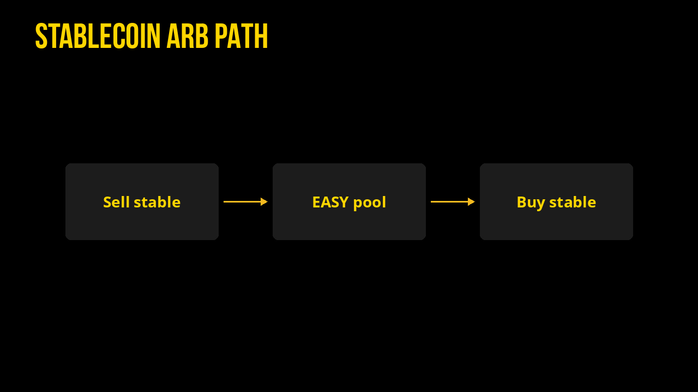

# Stablecoin Arbitrage (XPR)

Dated cross-rates for selling each of **XMD · XUSDC · XPYUSD · XPAX · XUSDT** into the others on Alcor (XPR Network).

*Snapshot: **2026-11-19 21:05 UTC** · Primary path: deepest **EASY**↔stable pools*

## Cross-rate heatmap (+/- percent)

## How to read

- Rows = **sell** this coin. Columns = **buy** that coin.
- Cell = how many **buy** tokens you get per **1.0 sell** token (implied), routing **sell → EASY → buy**.
- Heatmap / percent table = distance from 1.0000 (parity) as **+/- percent** (green when you receive more than 1.0 of a same-peg asset after fees/slippage). Always simulate on [Alcor Swap](https://alcor.exchange/v/xpr/swap) before sizing.

Fees, hop slippage, and pool depth can erase small edges. EASY transfer tax (2%) applies when EASY moves to non-exempt accounts. Prefer routing that stays inside `swap.alcor` memos when possible.

## Implied rates via EASY (amount of Buy per 1 Sell)

| Sell ↓ \ Buy → | XMD | XUSDC | XPYUSD | XPAX | XUSDT |
| --- | ---: | ---: | ---: | ---: | ---: |
| **XMD** | 1.000000 | 1.000435 | 0.991925 | 1.002043 | 0.988764 |
| **XUSDC** | 0.999565 | 1.000000 | 0.991494 | 1.001607 | 0.988334 |
| **XPYUSD** | 1.008141 | 1.008579 | 1.000000 | 1.010200 | 0.996813 |
| **XPAX** | 0.997961 | 0.998396 | 0.989903 | 1.000000 | 0.986748 |
| **XUSDT** | 1.011364 | 1.011803 | 1.003197 | 1.013429 | 1.000000 |

### Same matrix as +/- percent vs 1.000

| Sell ↓ \ Buy → | XMD | XUSDC | XPYUSD | XPAX | XUSDT |
| --- | ---: | ---: | ---: | ---: | ---: |
| **XMD** | +0.00 | +0.04 | -0.81 | +0.20 | -1.12 |
| **XUSDC** | -0.04 | +0.00 | -0.85 | +0.16 | -1.17 |
| **XPYUSD** | +0.81 | +0.86 | +0.00 | +1.02 | -0.32 |
| **XPAX** | -0.20 | -0.16 | -1.01 | +0.00 | -1.33 |
| **XUSDT** | +1.14 | +1.18 | +0.32 | +1.34 | +0.00 |

## Standout legs (this snapshot)

- Sell **XUSDT** → buy **XPAX**: **1.013429** (+1.34% vs parity) via EASY
- Sell **XUSDT** → buy **XUSDC**: **1.011803** (+1.18% vs parity) via EASY
- Sell **XUSDT** → buy **XMD**: **1.011364** (+1.14% vs parity) via EASY
- Sell **XPYUSD** → buy **XPAX**: **1.010200** (+1.02% vs parity) via EASY
- Sell **XPYUSD** → buy **XUSDC**: **1.008579** (+0.86% vs parity) via EASY
- Sell **XPAX** → buy **XUSDT**: **0.986748** (-1.33% vs parity) via EASY
- Sell **XUSDC** → buy **XUSDT**: **0.988334** (-1.17% vs parity) via EASY
- Sell **XMD** → buy **XUSDT**: **0.988764** (-1.12% vs parity) via EASY
- Sell **XPAX** → buy **XPYUSD**: **0.989903** (-1.01% vs parity) via EASY
- Sell **XUSDC** → buy **XPYUSD**: **0.991494** (-0.85% vs parity) via EASY

## EASY pool anchors

**Stable TVL** = USD value of the non-EASY side only (XMD / XUSDC / XPYUSD / XPAX / XUSDT depth in that pool).

| Stable | Pool | EASY per 1 stable | Stable TVL | 24h vol |
| --- | --- | ---: | ---: | ---: |
| XMD | [4067](https://alcor.exchange/v/xpr/analytics/pools/4067) | 58.4237 | $527 | $202 |
| XUSDC | [4065](https://alcor.exchange/v/xpr/analytics/pools/4065) | 58.3983 | $12,959 | $3,930 |
| XPYUSD | [4068](https://alcor.exchange/v/xpr/analytics/pools/4068) | 58.8993 | $12,851 | $191 |
| XPAX | [4070](https://alcor.exchange/v/xpr/analytics/pools/4070) | 58.3046 | $13,027 | $59 |
| XUSDT | [4066](https://alcor.exchange/v/xpr/analytics/pools/4066) | 59.0876 | $12,637 | $1,519 |

### Alcor mark prices

| Stable | usd_price |
| --- | ---: |
| XMD | $0.9706 |
| XUSDC | $1.0000 |
| XPYUSD | $1.0099 |
| XPAX | $0.9995 |
| XUSDT | $1.0000 |
