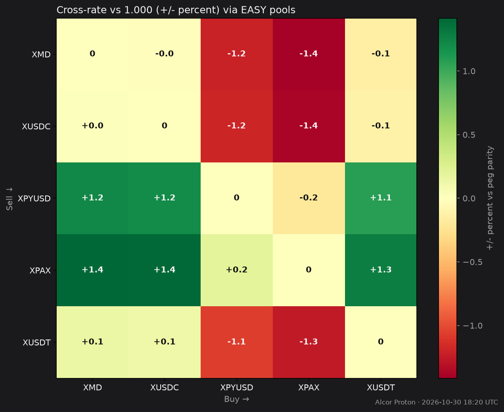
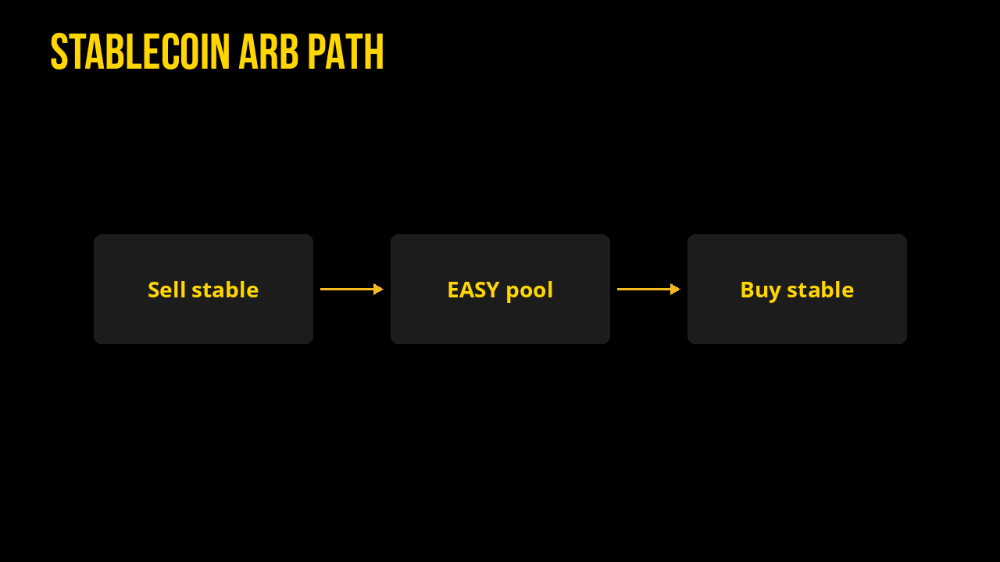

# Stablecoin Arbitrage (XPR)

Dated cross-rates for selling each of **XMD · XUSDC · XPYUSD · XPAX · XUSDT** into the others on Alcor (XPR Network).

*Snapshot: **2026-10-30 18:20 UTC** · Primary path: deepest **EASY**↔stable pools*

## Cross-rate heatmap (+/- percent)

## How to read

- Rows = **sell** this coin. Columns = **buy** that coin.
- Cell = how many **buy** tokens you get per **1.0 sell** token (implied), routing **sell → EASY → buy**.
- Heatmap / percent table = distance from 1.0000 (parity) as **+/- percent** (green when you receive more than 1.0 of a same-peg asset after fees/slippage). Always simulate on [Alcor Swap](https://alcor.exchange/v/xpr/swap) before sizing.

Fees, hop slippage, and pool depth can erase small edges. EASY transfer tax (2%) applies when EASY moves to non-exempt accounts. Prefer routing that stays inside `swap.alcor` memos when possible.

## Implied rates via EASY (amount of Buy per 1 Sell)

| Sell ↓ \ Buy → | XMD | XUSDC | XPYUSD | XPAX | XUSDT |
| --- | ---: | ---: | ---: | ---: | ---: |
| **XMD** | 1.000000 | 0.999790 | 0.987937 | 0.986047 | 0.998608 |
| **XUSDC** | 1.000210 | 1.000000 | 0.988145 | 0.986254 | 0.998818 |
| **XPYUSD** | 1.012210 | 1.011997 | 1.000000 | 0.998087 | 1.010801 |
| **XPAX** | 1.014150 | 1.013937 | 1.001917 | 1.000000 | 1.012738 |
| **XUSDT** | 1.001394 | 1.001184 | 0.989315 | 0.987422 | 1.000000 |

### Same matrix as +/- percent vs 1.000

| Sell ↓ \ Buy → | XMD | XUSDC | XPYUSD | XPAX | XUSDT |
| --- | ---: | ---: | ---: | ---: | ---: |
| **XMD** | +0.00 | -0.02 | -1.21 | -1.40 | -0.14 |
| **XUSDC** | +0.02 | +0.00 | -1.19 | -1.37 | -0.12 |
| **XPYUSD** | +1.22 | +1.20 | +0.00 | -0.19 | +1.08 |
| **XPAX** | +1.42 | +1.39 | +0.19 | +0.00 | +1.27 |
| **XUSDT** | +0.14 | +0.12 | -1.07 | -1.26 | +0.00 |

## Standout legs (this snapshot)

- Sell **XPAX** → buy **XMD**: **1.014150** (+1.42% vs parity) via EASY
- Sell **XPAX** → buy **XUSDC**: **1.013937** (+1.39% vs parity) via EASY
- Sell **XPAX** → buy **XUSDT**: **1.012738** (+1.27% vs parity) via EASY
- Sell **XPYUSD** → buy **XMD**: **1.012210** (+1.22% vs parity) via EASY
- Sell **XPYUSD** → buy **XUSDC**: **1.011997** (+1.20% vs parity) via EASY
- Sell **XMD** → buy **XPAX**: **0.986047** (-1.40% vs parity) via EASY
- Sell **XUSDC** → buy **XPAX**: **0.986254** (-1.37% vs parity) via EASY
- Sell **XUSDT** → buy **XPAX**: **0.987422** (-1.26% vs parity) via EASY
- Sell **XMD** → buy **XPYUSD**: **0.987937** (-1.21% vs parity) via EASY
- Sell **XUSDC** → buy **XPYUSD**: **0.988145** (-1.19% vs parity) via EASY

## EASY pool anchors

**Stable TVL** = USD value of the non-EASY side only (XMD / XUSDC / XPYUSD / XPAX / XUSDT depth in that pool).

| Stable | Pool | EASY per 1 stable | Stable TVL | 24h vol |
| --- | --- | ---: | ---: | ---: |
| XMD | [4067](https://alcor.exchange/v/xpr/analytics/pools/4067) | 53.2921 | $529 | $141 |
| XUSDC | [4065](https://alcor.exchange/v/xpr/analytics/pools/4065) | 53.3033 | $15,527 | $5,016 |
| XPYUSD | [4068](https://alcor.exchange/v/xpr/analytics/pools/4068) | 53.9428 | $15,331 | $185 |
| XPAX | [4070](https://alcor.exchange/v/xpr/analytics/pools/4070) | 54.0462 | $15,466 | $20 |
| XUSDT | [4066](https://alcor.exchange/v/xpr/analytics/pools/4066) | 53.3664 | $15,493 | $1,492 |

### Alcor mark prices

| Stable | usd_price |
| --- | ---: |
| XMD | $1.0005 |
| XUSDC | $1.0000 |
| XPYUSD | $1.0096 |
| XPAX | $1.0201 |
| XUSDT | $1.0000 |
