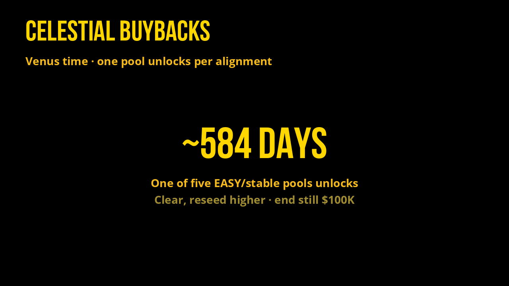
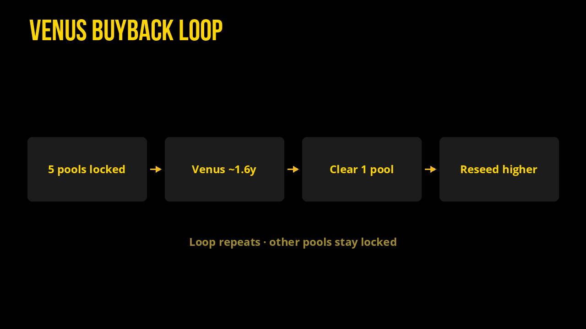
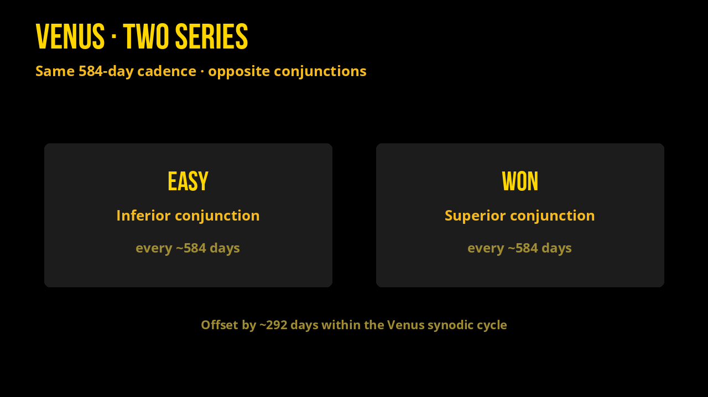

# Celestial Buybacks

Day-one project liquidity stays **date-locked** until a Venus window. Then **one** pool is cleared and re-seeded higher.

## Venus buybacks

Five EASY/stable project pools lock until Venus alignments (**≈584 days** / ≈1.6 years, inferior conjunction). At each alignment, **exactly one** pool unlocks: clear it, redeploy stables + EASY at a new range (start = current market price; end still **$100,000 / EASY**). The other four stay locked.

| | |
| --- | --- |
| **Cadence** | Every **≈584 days** |
| **What unlocks** | **One** of the five project EASY/stable pools |
| **What happens** | Clear that pool → redeploy at a higher band |
| **Range** | New start = market · end = **$100,000 / EASY** |

[YouTube explanation](https://www.youtube.com/watch?v=HoZTD60D1lw)

### Project pools

| Pool | Window | Alcor |
| --- | --- | --- |
| EASY / XMD | October 24, 2026 | [4067](https://alcor.exchange/v/xpr/analytics/pools/4067) |
| EASY / XUSDC | June 1, 2028 | [4065](https://alcor.exchange/v/xpr/analytics/pools/4065) |
| EASY / XUSDT | January 6, 2030 | [4066](https://alcor.exchange/v/xpr/analytics/pools/4066) |
| EASY / XPYUSD | August 11, 2031 | [4068](https://alcor.exchange/v/xpr/analytics/pools/4068) |
| EASY / XPAX | March 18, 2033 | [4070](https://alcor.exchange/v/xpr/analytics/pools/4070) |

Each window is that pool's Venus inferior conjunction.

October 24, 2026

The buyback was used to position into new Alcor wraps, USDC and USDT (`wrap.alcor`). EASY in the pools was reallocated.

| Book | Fee | Range | Share |
| --- | ---: | --- | ---: |
| [XMD / EASY](https://alcor.exchange/v/xpr/analytics/pools/4067) | 0.05% | ceiling stays $100,000 | 70% |
| [XMD / EASY](https://alcor.exchange/v/xpr/analytics/pools/8936) | 1% | up to $1 | 10% |
| [USDC / EASY](https://alcor.exchange/v/xpr/analytics/pools/11807) | 1% | up to $1 | 10% |
| [USDT / EASY](https://alcor.exchange/v/xpr/analytics/pools/11808) | 1% | up to $1 | 10% |

**800,000 EASY** was bought back.

- **400,000** bridged to Solana LP

SOL · USDC · ORE · JUP · PUMP · RAY · ORCA · JLP

[SOL](https://www.orca.so/pools/Cakez96K8yJxxNhVJDkHzsQXPQXZghAWmvSPomchipaY) 2% · [USDC](https://www.orca.so/pools/9hCeJAcU1ipEfGdabuFLfJJuSFHUeAU1Wcde8ZB1188y) 1% · [ORE](https://www.orca.so/pools/GHjNT3YvMkHSbLF7mfpXnM5t9ezmPtTr6pd1rn1uSCe5) 2% · [JUP](https://www.orca.so/pools/DDMMX1LjdDN7w2fk9Mmp57yMsRbff3moxrk7YMB6tH3z) 2% · [PUMP](https://www.orca.so/pools/AEpxeLXuqRN2ZxuAkjqfSZAZPAtCQwLPEezJ1LJh313n) 2% · [RAY](https://www.orca.so/pools/Duz3wt3ergkT2UtT52kPX3U4DWXwkD18DAjJv2GacvBv) 1% · [ORCA](https://www.orca.so/pools/7M2WtZ2B4xE8erpZQfAp5agokPp2uQnfAnkcXQmfD96N) 2% · [JLP](https://www.orca.so/pools/GcsREfXYHUV6oNbPpinvC7BGcEfGuzFJHAXiURUiJ53H) 2%, on Orca.

- **100,000** LP on Telos for bridged network tokens

TLOS · XPR · ETH · BNB · POL · USDC · USDT · A · SEEDS

[TLOS](https://alcor.exchange/v/telos/analytics/pools/126) · [XPR](https://alcor.exchange/v/telos/analytics/pools/129) · [ETH](https://alcor.exchange/v/telos/analytics/pools/132) · [BNB](https://alcor.exchange/v/telos/analytics/pools/128) · [POL](https://alcor.exchange/v/telos/analytics/pools/127) · [USDC](https://alcor.exchange/v/telos/analytics/pools/124) · [USDT](https://alcor.exchange/v/telos/analytics/pools/131) · [A](https://alcor.exchange/v/telos/analytics/pools/133) · [SEEDS](https://alcor.exchange/v/telos/analytics/pools/134). XPR, ETH, BNB, POL, USDC, USDT, and A are `wrap.alcor`. TLOS is native. SEEDS is `token.seeds`.

- **10,000** LP with [MEME](https://alcor.exchange/v/xpr/analytics/pools/6990)
- **90,000** LP with [XPR](https://alcor.exchange/v/xpr/analytics/pools/4512)
- **200,000** reserved for Flexdex, the Invite program, grassroots movements, and Flex Launcher. Final distribution TBD.

Between beats: stable-side swap fees buy EASY into the reflection pool (98% of the EASY that comes back). EASY-side fees split 10% Welcome, 25% Club, 10% MEME buyback, 55% reflection pool. See [Liquidity & Farms](core-tech/liquidity-and-farms.md).

## WON buybacks

Same **≈584-day** cadence, keyed to **superior conjunction** (≈292 days from EASY’s beat). Buybacks support the WON / EASY stack.

Live depth: [Market Stats](market-stats.md) · Trade: [Swap EASY](https://alcor.exchange/v/xpr/swap?input=XUSDC-xtokens&output=EASY-mon3y).
