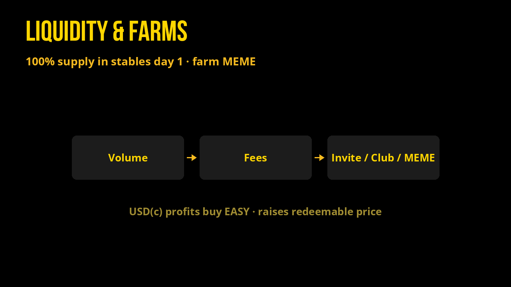
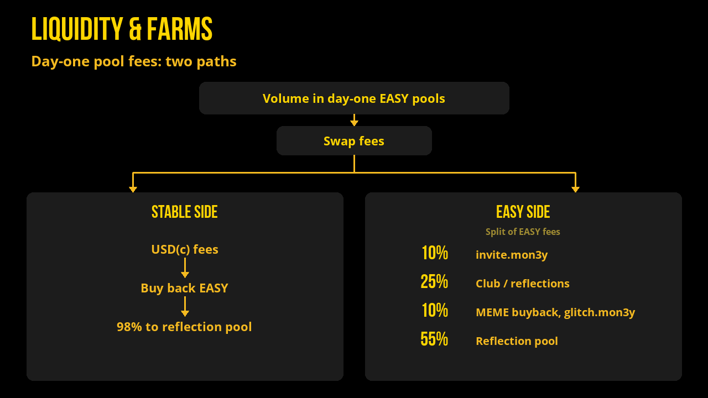

# Liquidity & Farms

Day-one EASY sat in five date-locked stable pools. The October 24, 2026 Venus window cleared EASY / XMD and moved that liquidity. The other four project pools stay locked. Extra books (XPR, XXRP, METAL, XBTC, and others) sit on Alcor. Prefer **1% fee** pools when you LP. Opt out of tax on the LP account first so deposits and exits are not hit with 2%.

`hands.mon3y` routes pool fees. Stable-side fees buy EASY, and **98%** of the EASY that comes back joins the reflection pool. EASY-side fees split **10%** Welcome ([`invite.mon3y`](https://explorer.xprnetwork.org/account/invite.mon3y)), **25%** Contributors Club (`reflections`), **10%** MEME buyback into locked [`glitch.mon3y`](https://explorer.xprnetwork.org/account/glitch.mon3y) through [EASY / MEME 6990](https://alcor.exchange/v/xpr/analytics/pools/6990), and **55%** to the reflection pool on `mon3y`. See [Tokenomics](../tokenomics.md).

Liquidity positions are managed within the `reflections` account and go back to the rewards pool. View them on Alcor anytime by searching `reflections`.

Additionally, `m3m3` feeds the `reflections` account with their earned LP fees.

Farms: [alcor.exchange/v/xpr/analytics?tab=farms](https://alcor.exchange/v/xpr/analytics?tab=farms)

## October 24, 2026 window

That buyback was used to position into new Alcor wraps, USDC and USDT (`wrap.alcor`). EASY in the pools was reallocated.

| Book | Fee | Range | Share |
| --- | ---: | --- | ---: |
| [XMD / EASY](https://alcor.exchange/v/xpr/analytics/pools/4067) | 0.05% | ceiling stays $100,000 | 70% |
| [XMD / EASY](https://alcor.exchange/v/xpr/analytics/pools/8936) | 1% | up to $1 | 10% |
| [USDC / EASY](https://alcor.exchange/v/xpr/analytics/pools/11807) | 1% | up to $1 | 10% |
| [USDT / EASY](https://alcor.exchange/v/xpr/analytics/pools/11808) | 1% | up to $1 | 10% |

**800,000 EASY** was bought back.

- **400,000** bridged to Solana LP

SOL · USDC · ORE · JUP · PUMP · RAY · ORCA · JLP

[SOL](https://www.orca.so/pools/Cakez96K8yJxxNhVJDkHzsQXPQXZghAWmvSPomchipaY) 2% · [USDC](https://www.orca.so/pools/9hCeJAcU1ipEfGdabuFLfJJuSFHUeAU1Wcde8ZB1188y) 1% · [ORE](https://www.orca.so/pools/GHjNT3YvMkHSbLF7mfpXnM5t9ezmPtTr6pd1rn1uSCe5) 2% · [JUP](https://www.orca.so/pools/DDMMX1LjdDN7w2fk9Mmp57yMsRbff3moxrk7YMB6tH3z) 2% · [PUMP](https://www.orca.so/pools/AEpxeLXuqRN2ZxuAkjqfSZAZPAtCQwLPEezJ1LJh313n) 2% · [RAY](https://www.orca.so/pools/Duz3wt3ergkT2UtT52kPX3U4DWXwkD18DAjJv2GacvBv) 1% · [ORCA](https://www.orca.so/pools/7M2WtZ2B4xE8erpZQfAp5agokPp2uQnfAnkcXQmfD96N) 2% · [JLP](https://www.orca.so/pools/GcsREfXYHUV6oNbPpinvC7BGcEfGuzFJHAXiURUiJ53H) 2%, on Orca.

- **100,000** LP on Telos for bridged network tokens

TLOS · XPR · ETH · BNB · POL · USDC · USDT · A · SEEDS

[TLOS](https://alcor.exchange/v/telos/analytics/pools/126) · [XPR](https://alcor.exchange/v/telos/analytics/pools/129) · [ETH](https://alcor.exchange/v/telos/analytics/pools/132) · [BNB](https://alcor.exchange/v/telos/analytics/pools/128) · [POL](https://alcor.exchange/v/telos/analytics/pools/127) · [USDC](https://alcor.exchange/v/telos/analytics/pools/124) · [USDT](https://alcor.exchange/v/telos/analytics/pools/131) · [A](https://alcor.exchange/v/telos/analytics/pools/133) · [SEEDS](https://alcor.exchange/v/telos/analytics/pools/134). XPR, ETH, BNB, POL, USDC, USDT, and A are `wrap.alcor`. TLOS is native. SEEDS is `token.seeds`.

- **10,000** LP with [MEME](https://alcor.exchange/v/xpr/analytics/pools/6990)
- **90,000** LP with [XPR](https://alcor.exchange/v/xpr/analytics/pools/4512)
- **200,000** reserved for Flexdex, the Invite program, grassroots movements, and Flex Launcher. Final distribution TBD.

Remaining lock dates: [Celestial Buybacks](../celestial-buybacks.md).
