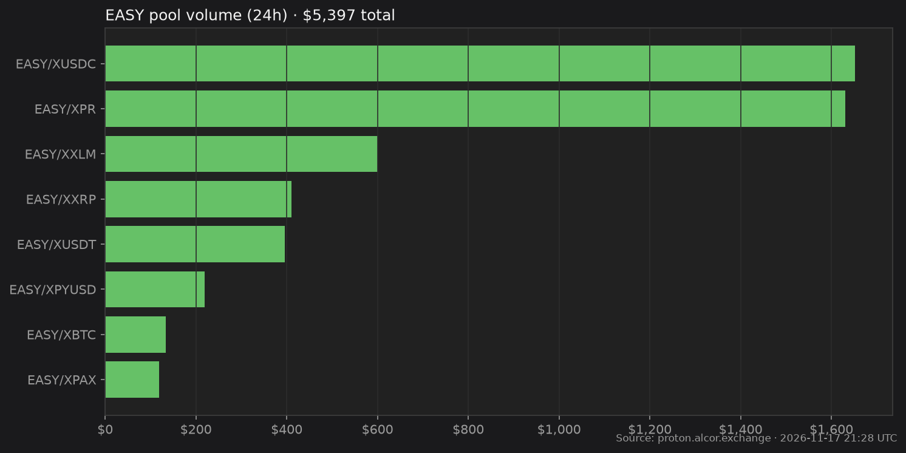

# Market Stats

Live pulse of EASY on XPR Alcor: liquidity, volume, and pending holder rewards.

*Last updated: 2026-11-18 21:00 UTC · Sources: [Alcor API](https://api.alcor.exchange/) (`proton.alcor.exchange/api/v2`) + `mon3y` chain tables*

## At a glance

| | |
| --- | --- |
| **24h volume (all EASY pools)** | **$13,415** |
| **EASY price** | **$0.0170** (≈11.03 XPR) |
| **EASY price in XUSDC** | **0.017084 XUSDC** |
| **Total EASY pools TVL** | **$347,324** |
| **Total USD backing (stables)** | **$52,287** (XMD + XUSDC + XPYUSD + XPAX + XUSDT sides) |
| **Pending holder rewards** | **961.94 EASY** (≈$16.36) in the reflection pool |
| **7d volume** | **$82,922** |
| **30d volume** | **$352,085** |
| **Flexers (holders on contract)** | **6,072** |
| **Market cap (fully circulating)** | **$357,254** |
| **Share of Alcor Proton swap volume (24h)** | **≈38.35%** |

## Volume

EASY pool volume is the sum of `volumeUSD24` / `volumeUSDWeek` / `volumeUSDMonth` across every Alcor swap pool where one side is `EASY@mon3y`.

**Share** = EASY volume ÷ Alcor Proton **swap** volume for the **same window** (`analytics/global` resolutions `1D` / `1W` / `1M`). That answers: *how much of Alcor’s swap tape is EASY?*

| Window | EASY pools | Rest of Alcor swap | EASY share |
| --- | ---: | ---: | ---: |
| 24h | $13,415 | $21,566 | **38.4%** |
| 7d | $82,922 | $189,624 | **30.4%** |
| 30d | $352,085 | $805,913 | **30.4%** |

### Top EASY pools (24h)

| Pool | 24h volume | TVL | EASY in pool | Other side | 24h Δ |
| --- | ---: | ---: | ---: | ---: | ---: |
| EASY/XUSDC | $4,626 | $67,620 | 3,213,727 EASY | 12,894.63 XUSDC | -0.4% |
| EASY/XXRP | $3,242 | $14,319 | 115,298 EASY | 12,803.21 XXRP | -0.7% |
| EASY/XUSDT | $2,234 | $67,619 | 3,220,468 EASY | 12,779.30 XUSDT | -0.5% |
| EASY/XPR | $1,364 | $9,618 | 98,379 EASY | 5,105,801.71 XPR | -1.4% |
| EASY/XXLM | $429.09 | $3,605 | 41,712 EASY | 21,012.05 XXLM | +0.2% |
| EASY/XMD | $355.10 | $37,292 | 2,158,705 EASY | 540.02 XMD | -0.3% |
| EASY/METAL | $344.42 | $6,383 | 368,855 EASY | 1,044.37 METAL | +0.3% |
| EASY/XSOL | $335.30 | $2,470 | 79,937 EASY | 15.19 XSOL | -2.0% |

### Stable backing (deepest pool each)

| Pool | Stable side | EASY in pool | Pool TVL |
| --- | ---: | ---: | ---: |
| [EASY/XMD](https://alcor.exchange/v/xpr/analytics/pools/4067) | $527.70 XMD | 2,158,705 EASY | $37,292 |
| [EASY/XUSDC](https://alcor.exchange/v/xpr/analytics/pools/4065) | $12,895 XUSDC | 3,213,727 EASY | $67,620 |
| [EASY/XPYUSD](https://alcor.exchange/v/xpr/analytics/pools/4068) | $12,874 XPYUSD | 3,214,194 EASY | $54,733 |
| [EASY/XPAX](https://alcor.exchange/v/xpr/analytics/pools/4070) | $13,146 XPAX | 3,202,202 EASY | $54,529 |
| [EASY/XUSDT](https://alcor.exchange/v/xpr/analytics/pools/4066) | $12,779 XUSDT | 3,220,468 EASY | $67,619 |

Trade: [alcor.exchange/v/xpr/swap](https://alcor.exchange/v/xpr/swap) · Analytics: [EASY token](https://alcor.exchange/v/xpr/analytics/tokens/EASY-mon3y)

## Alcor Proton (exchange-wide)

| | 1D | 1W | 1M |
| --- | ---: | ---: | ---: |
| **TVL** | $835,652 | (snapshot) | (snapshot) |
| **Swap TVL** | $745,951 | - | - |
| **Swap volume** | $34,981 | $272,546 | $1,157,998 |
| **Spot volume** | $63.18 | $1,989 | $5,819 |
| **Swap fees** | $205.03 | $1,554 | $6,175 |
| **DAU (avg)** | ≈363 | ≈371 | ≈365 |
| **Liquidity pools** | 11,864 | - | - |
| **Spot pairs** | 1,681 | - | - |

## Holder rewards (on-chain)

| | |
| --- | --- |
| Reflection pool (`mon3y` / EASY `stat`) | **961.94 EASY** |
| Approx. USD | **≈$16.36** |
| How it fills | 2% transfer tax into the pool |
| How it pays | Anyone calls `distribute` → splash to flexers |

Track real bags over time on [Success Stories](our-story/success-stories.md).
