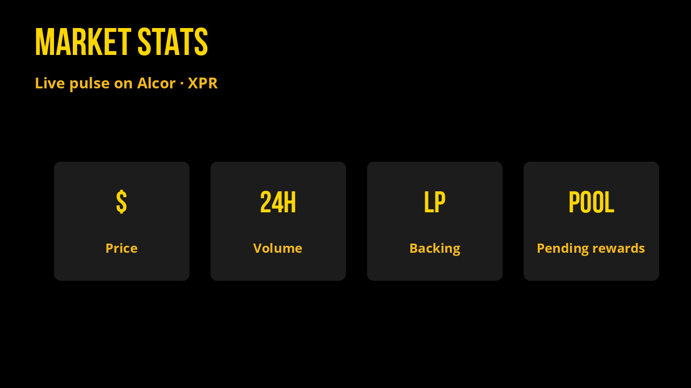

# Market Stats

Live pulse of EASY on XPR Alcor: liquidity, volume, and pending holder rewards.

*Last updated: 2026-11-19 21:05 UTC · Sources: [Alcor API](https://api.alcor.exchange/) (`proton.alcor.exchange/api/v2`) + `mon3y` chain tables*

## At a glance

| | |
| --- | --- |
| **24h volume (all EASY pools)** | **$13,053** |
| **EASY price** | **$0.0169** (≈10.95 XPR) |
| **EASY price in XUSDC** | **0.017143 XUSDC** |
| **Total EASY pools TVL** | **$350,871** |
| **Total USD backing (stables)** | **$52,105** (XMD + XUSDC + XPYUSD + XPAX + XUSDT sides) |
| **Pending holder rewards** | **952.47 EASY** (≈$16.12) in the reflection pool |
| **7d volume** | **$83,089** |
| **30d volume** | **$358,168** |
| **Flexers (holders on contract)** | **6,072** |
| **Market cap (fully circulating)** | **$355,404** |
| **Share of Alcor Proton swap volume (24h)** | **≈32.99%** |

## Volume

EASY pool volume is the sum of `volumeUSD24` / `volumeUSDWeek` / `volumeUSDMonth` across every Alcor swap pool where one side is `EASY@mon3y`.

**Share** = EASY volume ÷ Alcor Proton **swap** volume for the **same window** (`analytics/global` resolutions `1D` / `1W` / `1M`). That answers: *how much of Alcor’s swap tape is EASY?*

| Window | EASY pools | Rest of Alcor swap | EASY share |
| --- | ---: | ---: | ---: |
| 24h | $13,053 | $26,508 | **33.0%** |
| 7d | $83,089 | $180,768 | **31.5%** |
| 30d | $358,168 | $822,194 | **30.3%** |

### Top EASY pools (24h)

| Pool | 24h volume | TVL | EASY in pool | Other side | 24h Δ |
| --- | ---: | ---: | ---: | ---: | ---: |
| EASY/XUSDC | $3,930 | $67,285 | 3,208,145 EASY | 12,990.00 XUSDC | +0.3% |
| EASY/XPR | $2,287 | $9,443 | 115,857 EASY | 4,840,909.00 XPR | +0.4% |
| EASY/XXRP | $1,672 | $14,233 | 130,522 EASY | 12,520.31 XXRP | -1.4% |
| EASY/XUSDT | $1,519 | $67,282 | 3,228,828 EASY | 12,637.12 XUSDT | -0.5% |
| EASY/USDC | $1,121 | $7,812 | 448,536 EASY | 220.70 USDC | +5.7% |
| EASY/METAL | $921.66 | $3,941 | 213,363 EASY | 3,467.35 METAL | +1.9% |
| EASY/XXLM | $650.67 | $3,494 | 36,849 EASY | 21,610.25 XXLM | +1.2% |
| EASY/XBTC | $261.86 | $5,983 | 101,422 EASY | 0.07 XBTC | +1.3% |

### Stable backing (deepest pool each)

| Pool | Stable side | EASY in pool | Pool TVL |
| --- | ---: | ---: | ---: |
| [EASY/XMD](https://alcor.exchange/v/xpr/analytics/pools/4067) | $528.69 XMD | 2,158,475 EASY | $37,059 |
| [EASY/XUSDC](https://alcor.exchange/v/xpr/analytics/pools/4065) | $12,990 XUSDC | 3,208,145 EASY | $67,285 |
| [EASY/XPYUSD](https://alcor.exchange/v/xpr/analytics/pools/4068) | $12,851 XPYUSD | 3,223,664 EASY | $54,557 |
| [EASY/XPAX](https://alcor.exchange/v/xpr/analytics/pools/4070) | $13,027 XPAX | 3,209,126 EASY | $54,311 |
| [EASY/XUSDT](https://alcor.exchange/v/xpr/analytics/pools/4066) | $12,637 XUSDT | 3,228,828 EASY | $67,282 |

Trade: [alcor.exchange/v/xpr/swap](https://alcor.exchange/v/xpr/swap) · Analytics: [EASY token](https://alcor.exchange/v/xpr/analytics/tokens/EASY-mon3y)

## Alcor Proton (exchange-wide)

| | 1D | 1W | 1M |
| --- | ---: | ---: | ---: |
| **TVL** | $833,648 | (snapshot) | (snapshot) |
| **Swap TVL** | $740,274 | - | - |
| **Swap volume** | $39,560 | $263,858 | $1,180,362 |
| **Spot volume** | $168.72 | $2,159 | $5,971 |
| **Swap fees** | $191.65 | $1,425 | $6,275 |
| **DAU (avg)** | ≈380 | ≈372 | ≈365 |
| **Liquidity pools** | 11,871 | - | - |
| **Spot pairs** | 1,681 | - | - |

## Holder rewards (on-chain)

| | |
| --- | --- |
| Reflection pool (`mon3y` / EASY `stat`) | **952.47 EASY** |
| Approx. USD | **≈$16.12** |
| How it fills | 2% transfer tax into the pool |
| How it pays | Anyone calls `distribute` → splash to flexers |

Track real bags over time on [Success Stories](our-story/success-stories.md).
