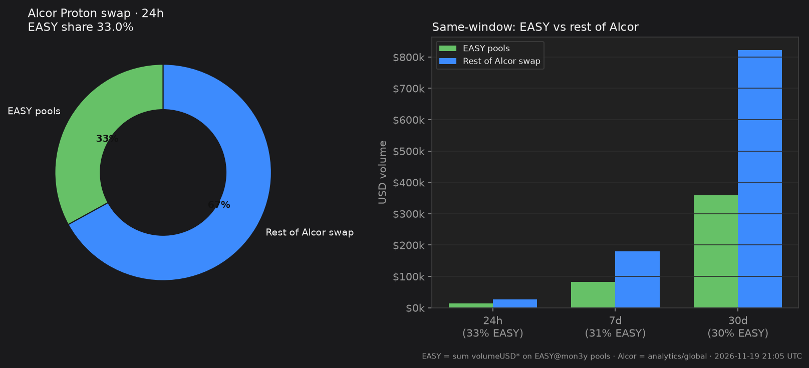

# Market Stats

Live pulse of EASY on XPR Alcor: liquidity, volume, and pending holder rewards.

*Last updated: 2026-11-15 19:11 UTC · Sources: [Alcor API](https://api.alcor.exchange/) (`proton.alcor.exchange/api/v2`) + `mon3y` chain tables*

## At a glance

| | |
| --- | --- |
| **24h volume (all EASY pools)** | **$21,884** |
| **EASY price** | **$0.0176** (≈9.84 XPR) |
| **EASY price in XUSDC** | **0.017581 XUSDC** |
| **Total EASY pools TVL** | **$353,654** |
| **Total USD backing (stables)** | **$55,352** (XMD + XUSDC + XPYUSD + XPAX + XUSDT sides) |
| **Pending holder rewards** | **944.88 EASY** (≈$16.59) in the reflection pool |
| **7d volume** | **$91,310** |
| **30d volume** | **$507,995** |
| **Flexers (holders on contract)** | **6,072** |
| **Market cap (fully circulating)** | **$368,666** |
| **Share of Alcor Proton swap volume (24h)** | **≈41.88%** |

## Volume

EASY pool volume is the sum of `volumeUSD24` / `volumeUSDWeek` / `volumeUSDMonth` across every Alcor swap pool where one side is `EASY@mon3y`.

**Share** = EASY volume ÷ Alcor Proton **swap** volume for the **same window** (`analytics/global` resolutions `1D` / `1W` / `1M`). That answers: *how much of Alcor’s swap tape is EASY?*

| Window | EASY pools | Rest of Alcor swap | EASY share |
| --- | ---: | ---: | ---: |
| 24h | $21,884 | $30,365 | **41.9%** |
| 7d | $91,310 | $265,723 | **25.6%** |
| 30d | $507,995 | $921,659 | **35.5%** |

### Top EASY pools (24h)

| Pool | 24h volume | TVL | EASY in pool | Other side | 24h Δ |
| --- | ---: | ---: | ---: | ---: | ---: |
| EASY/XUSDC | $6,559 | $69,303 | 3,167,944 EASY | 13,688.54 XUSDC | -0.9% |
| EASY/XXRP | $3,810 | $12,036 | 88,400 EASY | 11,231.35 XXRP | -0.7% |
| EASY/XUSDT | $3,056 | $69,302 | 3,170,198 EASY | 13,647.93 XUSDT | -0.2% |
| EASY/XPR | $2,446 | $10,668 | 316,782 EASY | 2,859,314.45 XPR | +0.1% |
| EASY/XXLM | $1,118 | $3,603 | 34,498 EASY | 21,907.96 XXLM | -3.5% |
| EASY/XSOL | $1,065 | $1,268 | 66,615 EASY | 1.40 XSOL | +0.0% |
| EASY/XPAX | $989.20 | $55,664 | 3,170,743 EASY | 13,700.07 XPAX | -0.9% |
| EASY/XBTC | $863.84 | $6,039 | 86,747 EASY | 0.07 XBTC | +2.1% |

### Stable backing (deepest pool each)

| Pool | Stable side | EASY in pool | Pool TVL |
| --- | ---: | ---: | ---: |
| [EASY/XMD](https://alcor.exchange/v/xpr/analytics/pools/4067) | $489.49 XMD | 2,157,791 EASY | $38,371 |
| [EASY/XUSDC](https://alcor.exchange/v/xpr/analytics/pools/4065) | $13,689 XUSDC | 3,167,944 EASY | $69,303 |
| [EASY/XPYUSD](https://alcor.exchange/v/xpr/analytics/pools/4068) | $13,662 XPYUSD | 3,169,589 EASY | $55,644 |
| [EASY/XPAX](https://alcor.exchange/v/xpr/analytics/pools/4070) | $13,753 XPAX | 3,170,743 EASY | $55,664 |
| [EASY/XUSDT](https://alcor.exchange/v/xpr/analytics/pools/4066) | $13,648 XUSDT | 3,170,198 EASY | $69,302 |

Trade: [alcor.exchange/v/xpr/swap](https://alcor.exchange/v/xpr/swap) · Analytics: [EASY token](https://alcor.exchange/v/xpr/analytics/tokens/EASY-mon3y)

## Alcor Proton (exchange-wide)

| | 1D | 1W | 1M |
| --- | ---: | ---: | ---: |
| **TVL** | $870,887 | (snapshot) | (snapshot) |
| **Swap TVL** | $773,534 | - | - |
| **Swap volume** | $52,249 | $357,033 | $1,429,654 |
| **Spot volume** | $773.65 | $2,210 | $6,014 |
| **Swap fees** | $277.23 | $2,054 | $7,613 |
| **DAU (avg)** | ≈366 | ≈377 | ≈368 |
| **Liquidity pools** | 11,856 | - | - |
| **Spot pairs** | 1,680 | - | - |

## Holder rewards (on-chain)

| | |
| --- | --- |
| Reflection pool (`mon3y` / EASY `stat`) | **944.88 EASY** |
| Approx. USD | **≈$16.59** |
| How it fills | 2% transfer tax into the pool |
| How it pays | Anyone calls `distribute` → splash to flexers |

Track real bags over time on [Success Stories](our-story/success-stories.md).
