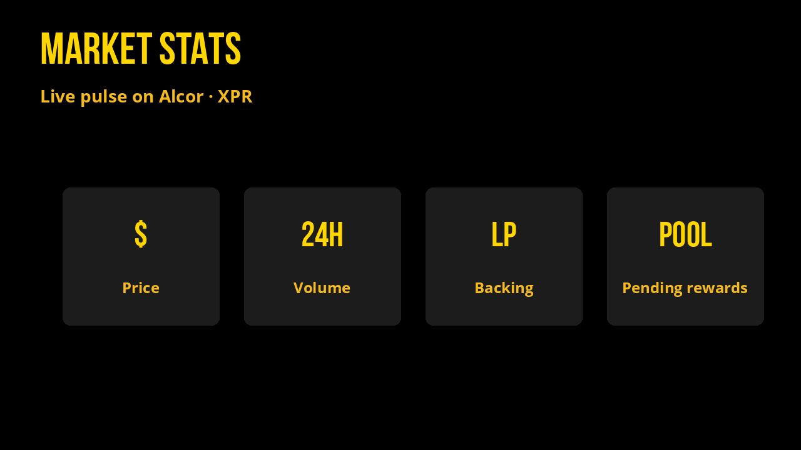
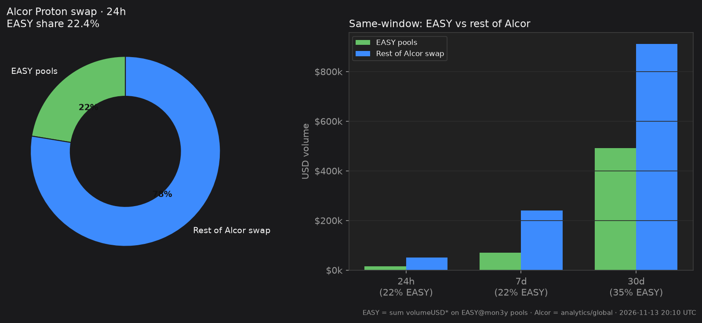
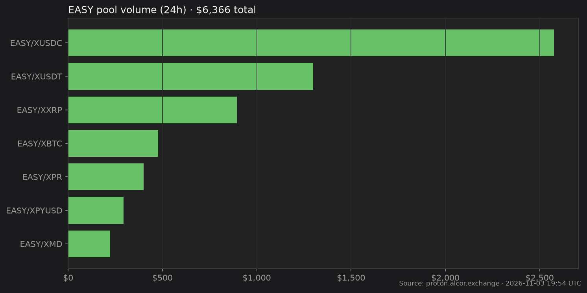

# Market Stats

Live pulse of EASY on XPR Alcor: liquidity, volume, and pending holder rewards.

*Last updated: 2026-11-07 17:54 UTC · Sources: [Alcor API](https://api.alcor.exchange/) (`proton.alcor.exchange/api/v2`) + `mon3y` chain tables*

## At a glance

| | |
| --- | --- |
| **24h volume (all EASY pools)** | **$6,377** |
| **EASY price** | **$0.0183** (≈10.42 XPR) |
| **EASY price in XUSDC** | **0.018345 XUSDC** |
| **Total EASY pools TVL** | **$359,558** |
| **Total USD backing (stables)** | **$60,161** (XMD + XUSDC + XPYUSD + XPAX + XUSDT sides) |
| **Pending holder rewards** | **1,410.84 EASY** (≈$25.88) in the reflection pool |
| **7d volume** | **$41,570** |
| **30d volume** | **$474,692** |
| **Flexers (holders on contract)** | **6,062** |
| **Market cap (fully circulating)** | **$385,239** |
| **Share of Alcor Proton swap volume (24h)** | **≈26.76%** |

## Volume

EASY pool volume is the sum of `volumeUSD24` / `volumeUSDWeek` / `volumeUSDMonth` across every Alcor swap pool where one side is `EASY@mon3y`.

**Share** = EASY volume ÷ Alcor Proton **swap** volume for the **same window** (`analytics/global` resolutions `1D` / `1W` / `1M`). That answers: *how much of Alcor’s swap tape is EASY?*

| Window | EASY pools | Rest of Alcor swap | EASY share |
| --- | ---: | ---: | ---: |
| 24h | $6,377 | $17,450 | **26.8%** |
| 7d | $41,570 | $123,851 | **25.1%** |
| 30d | $474,692 | $876,272 | **35.1%** |

### Top EASY pools (24h)

| Pool | 24h volume | TVL | EASY in pool | Other side | 24h Δ |
| --- | ---: | ---: | ---: | ---: | ---: |
| EASY/XUSDC | $2,445 | $71,776 | 3,101,222 EASY | 14,885.38 XUSDC | -1.1% |
| EASY/XXRP | $1,315 | $16,381 | 266,708 EASY | 9,756.50 XXRP | +3.1% |
| EASY/XUSDT | $845.19 | $71,779 | 3,124,823 EASY | 14,455.51 XUSDT | -2.1% |
| EASY/XPR | $756.38 | $13,664 | 400,837 EASY | 3,579,090.75 XPR | -2.0% |
| EASY/XPAX | $319.33 | $56,920 | 3,102,808 EASY | 14,919.26 XPAX | -1.2% |
| EASY/XPYUSD | $268.18 | $56,895 | 3,101,422 EASY | 14,881.50 XPYUSD | -1.2% |
| EASY/XBTC | $237.89 | $6,908 | 235,263 EASY | 0.03 XBTC | -1.2% |
| EASY/XXLM | $88.05 | $2,137 | 22,149 EASY | 11,351.46 XXLM | +0.0% |

### Stable backing (deepest pool each)

| Pool | Stable side | EASY in pool | Pool TVL |
| --- | ---: | ---: | ---: |
| [EASY/XMD](https://alcor.exchange/v/xpr/analytics/pools/4067) | $513.03 XMD | 2,157,176 EASY | $40,086 |
| [EASY/XUSDC](https://alcor.exchange/v/xpr/analytics/pools/4065) | $14,885 XUSDC | 3,101,222 EASY | $71,776 |
| [EASY/XPYUSD](https://alcor.exchange/v/xpr/analytics/pools/4068) | $15,015 XPYUSD | 3,101,422 EASY | $56,895 |
| [EASY/XPAX](https://alcor.exchange/v/xpr/analytics/pools/4070) | $15,052 XPAX | 3,102,808 EASY | $56,920 |
| [EASY/XUSDT](https://alcor.exchange/v/xpr/analytics/pools/4066) | $14,456 XUSDT | 3,124,823 EASY | $71,779 |

Trade: [alcor.exchange/v/xpr/swap](https://alcor.exchange/v/xpr/swap) · Analytics: [EASY token](https://alcor.exchange/v/xpr/analytics/tokens/EASY-mon3y)

## Alcor Proton (exchange-wide)

| | 1D | 1W | 1M |
| --- | ---: | ---: | ---: |
| **TVL** | $884,651 | (snapshot) | (snapshot) |
| **Swap TVL** | $786,927 | - | - |
| **Swap volume** | $23,828 | $165,420 | $1,350,964 |
| **Spot volume** | $18.30 | $420.33 | $5,841 |
| **Swap fees** | $122.88 | $951.64 | $7,032 |
| **DAU (avg)** | ≈352 | ≈343 | ≈378 |
| **Liquidity pools** | 11,836 | - | - |
| **Spot pairs** | 1,679 | - | - |

## Holder rewards (on-chain)

| | |
| --- | --- |
| Reflection pool (`mon3y` / EASY `stat`) | **1,410.84 EASY** |
| Approx. USD | **≈$25.88** |
| How it fills | 2% transfer tax into the pool |
| How it pays | Anyone calls `distribute` → splash to flexers |

Track real bags over time on [Success Stories](our-story/success-stories.md).
