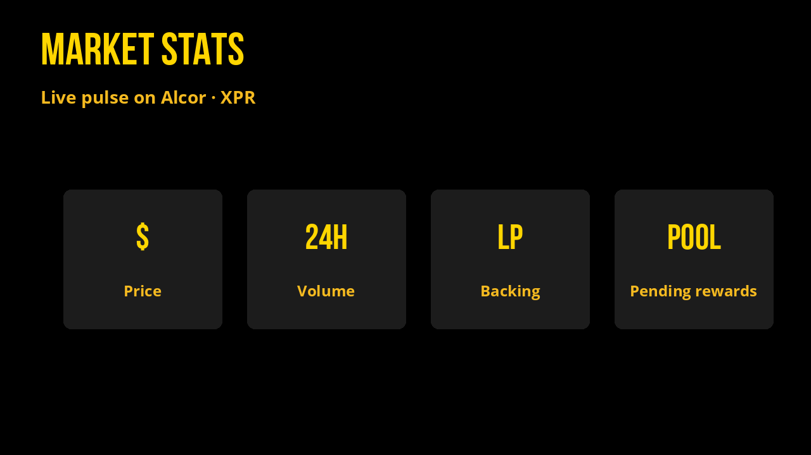
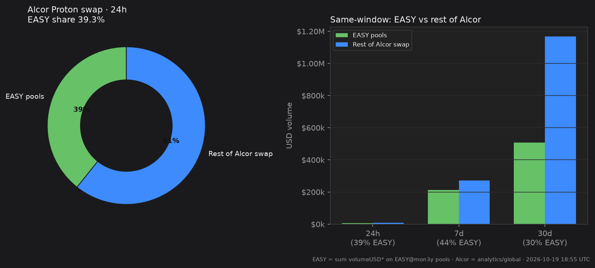
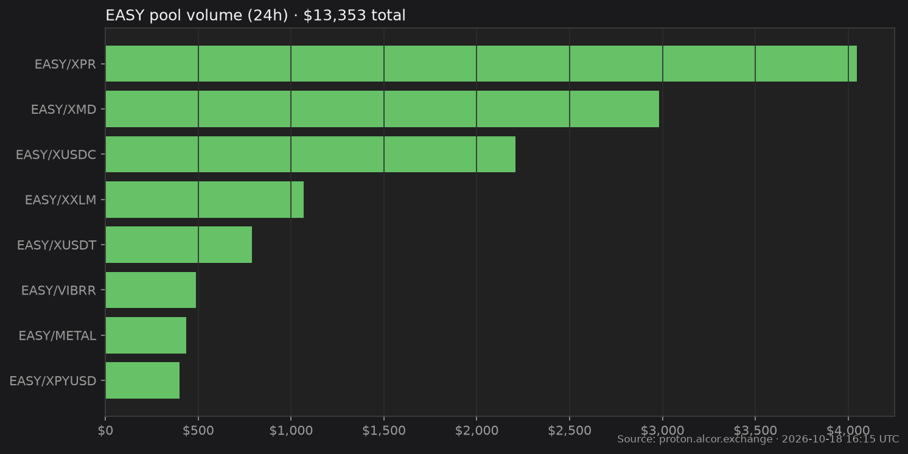

# Market Stats

Live pulse of EASY on XPR Alcor: liquidity, volume, and pending holder rewards.

*Last updated: 2026-10-28 18:35 UTC · Sources: [Alcor API](https://api.alcor.exchange/) (`proton.alcor.exchange/api/v2`) + `mon3y` chain tables*

## At a glance

| | |
| --- | --- |
| **24h volume (all EASY pools)** | **$15,214** |
| **EASY price** | **$0.0193** (≈10.12 XPR) |
| **EASY price in XUSDC** | **0.019341 XUSDC** |
| **Total EASY pools TVL** | **$383,747** |
| **Total USD backing (stables)** | **$64,962** (XMD + XUSDC + XPYUSD + XPAX + XUSDT sides) |
| **Pending holder rewards** | **2,651.38 EASY** (≈$51.22) in the reflection pool |
| **7d volume** | **$135,650** |
| **30d volume** | **$537,934** |
| **Flexers (holders on contract)** | **6,059** |
| **Market cap (fully circulating)** | **$405,655** |
| **Share of Alcor Proton swap volume (24h)** | **≈102.68%** |

## Volume

EASY pool volume is the sum of `volumeUSD24` / `volumeUSDWeek` / `volumeUSDMonth` across every Alcor swap pool where one side is `EASY@mon3y`.

**Share** = EASY volume ÷ Alcor Proton **swap** volume for the **same window** (`analytics/global` resolutions `1D` / `1W` / `1M`). That answers: *how much of Alcor’s swap tape is EASY?*

| Window | EASY pools | Rest of Alcor swap | EASY share |
| --- | ---: | ---: | ---: |
| 24h | $15,214 | $0.00 | **102.7%** |
| 7d | $135,650 | $211,334 | **39.1%** |
| 30d | $537,934 | $968,142 | **35.7%** |

### Top EASY pools (24h)

| Pool | 24h volume | TVL | EASY in pool | Other side | 24h Δ |
| --- | ---: | ---: | ---: | ---: | ---: |
| EASY/XUSDC | $6,858 | $74,756 | 3,020,351 EASY | 16,412.20 XUSDC | -2.0% |
| EASY/XPR | $2,671 | $14,460 | 406,355 EASY | 3,462,308.29 XPR | +4.9% |
| EASY/XUSDT | $2,516 | $74,754 | 3,022,178 EASY | 16,374.47 XUSDT | -1.4% |
| EASY/XPYUSD | $945.17 | $59,700 | 3,090,537 EASY | 15,082.79 XPYUSD | -0.7% |
| EASY/XXRP | $828.23 | $17,293 | 392,088 EASY | 7,373.44 XXRP | -2.1% |
| EASY/XBTC | $559.17 | $6,852 | 210,759 EASY | 0.03 XBTC | -2.6% |
| EASY/XPAX | $280.41 | $59,928 | 3,102,382 EASY | 14,927.26 XPAX | +1.8% |
| EASY/XMD | $83.76 | $42,199 | 2,156,893 EASY | 534.76 XMD | -1.9% |

### Stable backing (deepest pool each)

| Pool | Stable side | EASY in pool | Pool TVL |
| --- | ---: | ---: | ---: |
| [EASY/XMD](https://alcor.exchange/v/xpr/analytics/pools/4067) | $533.70 XMD | 2,156,893 EASY | $42,199 |
| [EASY/XUSDC](https://alcor.exchange/v/xpr/analytics/pools/4065) | $16,412 XUSDC | 3,020,351 EASY | $74,756 |
| [EASY/XPYUSD](https://alcor.exchange/v/xpr/analytics/pools/4068) | $15,623 XPYUSD | 3,090,537 EASY | $59,700 |
| [EASY/XPAX](https://alcor.exchange/v/xpr/analytics/pools/4070) | $15,536 XPAX | 3,102,382 EASY | $59,928 |
| [EASY/XUSDT](https://alcor.exchange/v/xpr/analytics/pools/4066) | $16,374 XUSDT | 3,022,178 EASY | $74,754 |

Trade: [alcor.exchange/v/xpr/swap](https://alcor.exchange/v/xpr/swap) · Analytics: [EASY token](https://alcor.exchange/v/xpr/analytics/tokens/EASY-mon3y)

## Alcor Proton (exchange-wide)

| | 1D | 1W | 1M |
| --- | ---: | ---: | ---: |
| **TVL** | $959,472 | (snapshot) | (snapshot) |
| **Swap TVL** | $854,627 | - | - |
| **Swap volume** | $14,817 | $346,984 | $1,506,076 |
| **Spot volume** | $26.40 | $2,226 | $9,775 |
| **Swap fees** | $62.17 | $1,629 | $7,797 |
| **DAU (avg)** | ≈330 | ≈383 | ≈400 |
| **Liquidity pools** | 11,818 | - | - |
| **Spot pairs** | 1,678 | - | - |

## Holder rewards (on-chain)

| | |
| --- | --- |
| Reflection pool (`mon3y` / EASY `stat`) | **2,651.38 EASY** |
| Approx. USD | **≈$51.22** |
| How it fills | 2% transfer tax into the pool |
| How it pays | Anyone calls `distribute` → splash to flexers |

Track real bags over time on [Success Stories](our-story/success-stories.md).
